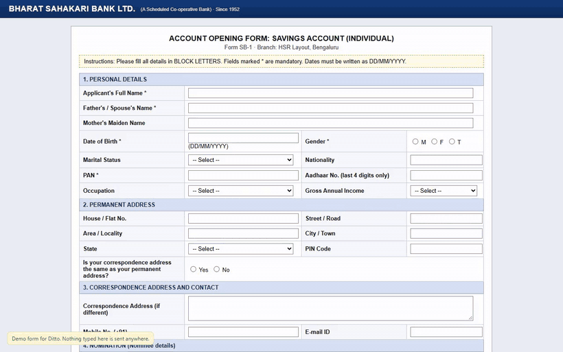
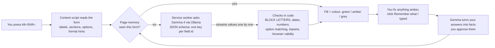

# Ditto 〃 type it once

**A Chrome extension that fills any web form from your private profile, using Gemma 4 running on your own computer through Ollama.**
Job portals, bank KYC, clinic intake, rental applications, college forms: they all ask the same forty questions in slightly different words. Ditto answers them for you, and your passport number never leaves your laptop.

[](https://github.com/dragon-slayer27/ditto/actions/workflows/ci.yml)




*A 26-field bank form filled by Gemma 4 E4B on a laptop CPU. Green came from the profile, amber means "please check", grey means "needs you".*

**Website and demo forms:** https://dragon-slayer27.github.io/ditto/

## Why

Browser autofill knows your name and email. It has no idea what "Father's / Spouse's Name", "Aadhaar No. (last 4 digits only)" or "Name as per PAN, in BLOCK LETTERS" means, so you type it all again, on every form, forever.

You *could* paste the form into a cloud chatbot along with your ID numbers, address and medical history. I wouldn't. Forms are exactly where we hand over our most sensitive facts, so this is a job for a small open model that runs locally, works offline and costs nothing per form.

## What it does

- **Fills any form, not just known sites.** Gemma reads every label *with its section*, so a "Name" under *Nominee details* gets your mother's name and the second "Phone" on a clinic form gets your emergency contact's number.
- **Follows the form's rules.** BLOCK LETTERS, DD/MM/YYYY, "last 4 digits only", "without country code", dropdowns, radio buttons, checkbox groups and `type=date` inputs. Formatting rules are enforced in code, not left to the model.
- **Never invents.** Every value goes through a tripwire that traces it back to your profile. Anything it can't trace (a calculated salary, a guessed head count) turns amber.
- **Gets lazier over time.** Type a missing answer once, click *Remember what I typed*, and Gemma turns it into a reusable fact. A form Ditto has seen before fills in under a second from page memory.
- **Lazy setup too.** Paste your resume or an old form into the profile page and Gemma pulls out the facts for you to approve.
- **Knows its limits.** It never submits, never ticks "I agree / I declare", never touches passwords, card numbers, OTPs or captchas, and leaves essay questions to you.
- **Works with React apps.** Values are set the way frameworks expect, and the eval checks that React's own state received them.

## How it works



A few details that made the difference:

| Problem | Fix |
|---|---|
| Ollama rejects requests from browser extensions | A `declarativeNetRequest` **session rule** strips the `Origin` header only for the extension's own requests (`tabIds: [-1]`), so it works with zero setup and web pages still can't reach your Ollama. |
| The first prompt format spent 45 output tokens per field (134 s for one form) | A per-form JSON schema with one required key per field id cut output 3.5x (51 s for the same form) and makes skipping or inventing fields impossible. |
| Small model + strict schema produced junk like `"},{"` for number fields | The schema allows real numbers as well as strings, so the model never fights the grammar. |
| Gemma forgot "BLOCK LETTERS" after the first section | The page's instructions are detected and uppercase is applied in code. |
| Values must appear as you watch, not all at the end | A tiny streaming JSON parser fills each field the moment its value is complete. |

## Results

Five realistic demo forms with traps (nominee sections, BLOCK LETTERS, "last 4 digits", consent boxes, essays, questions the profile can't answer), 114 fields in total. [`eval/run-eval.mjs`](eval/run-eval.mjs) drives the **real extension** in Chromium against [`eval/expected.json`](eval/expected.json). "Right" counts fields filled correctly **and** fields correctly left empty.

<!-- RESULTS:START -->
| Form | Fields | Right | Wrong but flagged amber | Wrong and shown green | First fill | Same form again |
|---|---|---|---|---|---|---|
| Job application (React) | 28 | 28 | 0 | 0 | 50 s | 0.1 s |
| Bank KYC (table layout) | 26 | 26 | 0 | 0 | 54 s | 0.1 s |
| Clinic intake | 23 | 23 | 0 | 0 | 45 s | 0.1 s |
| Rental application | 18 | 16 | 2 | 0 | 27 s | 0.1 s |
| Hackathon sign-up | 19 | 19 | 0 | 0 | 26 s | 0.1 s |
| **Total** | **114** | **112 (98.2%)** | 2 | 0 | 202 s | 0.4 s |
<!-- RESULTS:END -->

Gemma 4 E4B (QAT, Q4) on an Intel Core Ultra 5 125H laptop with 16 GB RAM, CPU only. Loading the model after a reboot takes another 40 to 70 seconds. Every non-right field is listed in [`eval/results/gemma4-e4b.md`](eval/results/gemma4-e4b.md).

### How small can the sloth be?

| Model | Download | Right | Wrong and shown green | Output speed (my CPU) |
|---|---|---|---|---|
| **Gemma 4 E4B** (default) | 6.1 GB | **112 / 114 (98.2%)** | **0** | 9.7 tokens/s |
| Gemma 4 E2B | 4.6 GB | 104 / 114 (91.2%) | 8 | 11.9 tokens/s |

E2B's mistakes are the instructive kind: it put the *current* Bengaluru address into the bank form's *Permanent address* section (six fields) and copied the annual salary into "monthly take-home income". Those are real facts in the wrong place, so the tripwire, which catches facts that aren't in your profile, can't see them. That's why Ditto picks E4B when it's installed. Details: [`eval/results/gemma4-e2b.md`](eval/results/gemma4-e2b.md).

The same eval also runs in the cloud: the [Model eval workflow](https://github.com/dragon-slayer27/ditto/actions/workflows/model-eval.yml) installs Ollama on a standard GitHub runner, pulls Gemma and fills all 114 fields with the real extension. Its [first run](https://github.com/dragon-slayer27/ditto/actions/runs/39649957127) took under five minutes and reproduced the finding: E2B scored 106/114 there, with the same permanent-address mistake.

## Install

1. Install [Ollama](https://ollama.com/download) and pull a Gemma model:
   ```sh
   ollama pull gemma4:e4b    # about 6 GB, best results
   ollama pull gemma4:e2b    # smaller, for 8 GB machines
   ```
2. Get the extension: download `ditto-extension.zip` from the [latest release](https://github.com/dragon-slayer27/ditto/releases/latest) and unzip it, or clone this repo.
3. Open `chrome://extensions`, switch on **Developer mode**, click **Load unpacked** and choose the `extension` folder.
4. The profile page opens. Paste your resume (Gemma extracts the facts), add facts by hand, or click **Load Meera** to try the fictional demo person.
5. Open any form, or the [demo forms](https://dragon-slayer27.github.io/ditto/forms/), and press **Alt+Shift+.** (Alt, Shift and the full-stop key). The toolbar icon and right-click > *Fill this form with Ditto* work too.

You don't need to change any Ollama settings.

**No shortcut?** Chrome quietly skips an extension's suggested shortcut when another extension already uses it. If that happens, Ditto's popup tells you, and its *Choose one* link opens `chrome://extensions/shortcuts`, where you can pick any combination. The toolbar icon and right-click menu work either way.

## Privacy and safety

- Ditto can't read a page until you press the button (`activeTab`). Its only permanent host permission is your own machine (`127.0.0.1` / `localhost`), where Ollama runs.
- Your profile and page memory live in the extension's local storage on your disk. Export or delete everything from the profile page.
- No analytics, no accounts, no remote code.

## Develop

```sh
npm install
npm run setup:browsers         # Playwright's Chromium, stored in .cache/
npm test                       # unit tests (no model needed)
node eval/extract-check.mjs    # loads the extension, checks extraction on all demo forms
node eval/shortcut-check.mjs   # keyboard shortcut, including when another extension owns it
npm run eval                   # full 114-field eval against your local Ollama
node eval/learn-demo.mjs       # the "remember what I typed" loop, end to end
node eval/inspect-fields.mjs   # print what Ditto sees on each demo form
npm run serve                  # demo site on http://127.0.0.1:8787
npm run pack                   # dist/ditto-extension.zip
```

GitHub Actions run the unit tests, the extraction check and the shortcut check on every push, deploy the site, attach the zip to tagged releases, and a manual **Model eval** workflow installs Ollama in the runner, pulls Gemma and runs the full 114-field eval in the cloud.

## Limitations

- Custom JavaScript dropdowns (ARIA comboboxes, like some big job portals use) aren't filled yet; native `<select>` elements are.
- Forms inside cross-origin iframes aren't reached.
- On a CPU, a fresh 25-field form takes about 30 to 50 seconds. That's slow next to autofill and fast next to you, and the same form is instant afterwards.
- Multi-page forms: press the shortcut on each page.
- The profile is stored unencrypted in the browser's extension storage, like other extension data.

## Credits

- [Gemma 4](https://ai.google.dev/gemma) by Google (Apache 2.0) does the reading and the learning.
- [Ollama](https://ollama.com) (MIT) runs it locally.
- React 18 (MIT) is vendored only for the demo job form; [Playwright](https://playwright.dev) (Apache 2.0) drives the tests.
- Built with GitHub Copilot as a pair programmer for the DEV Hacktoberfest Open-Source AI Challenge, Week 3: *Slow and Steady*.

## Challenge note

Started and built during the challenge window (October 19 to 25, 2026). Any commits made after the submission deadline will be listed here.

## License

MIT
